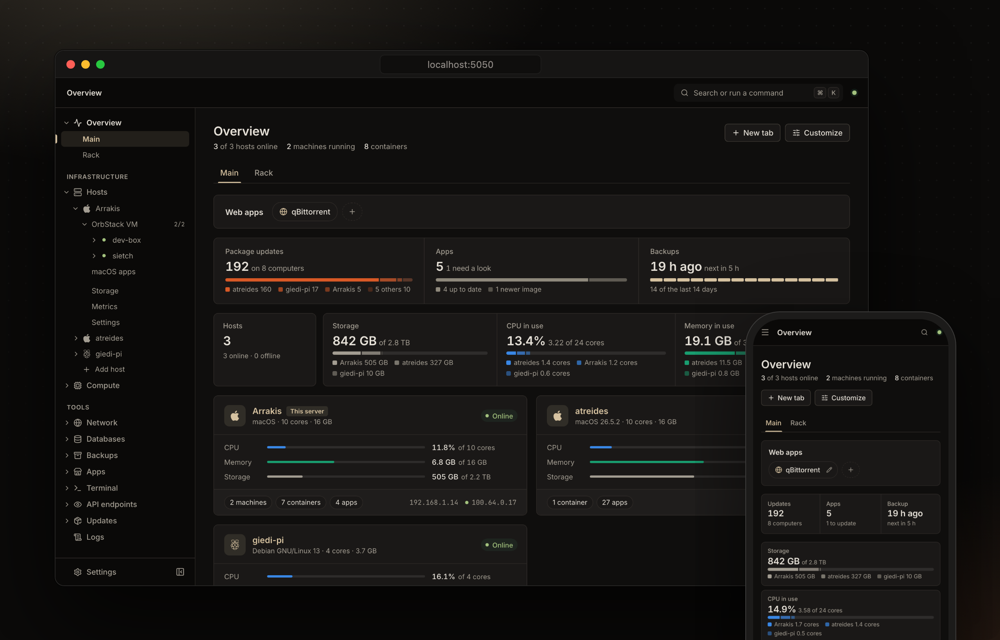
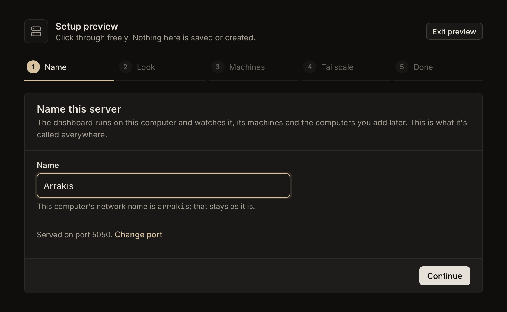
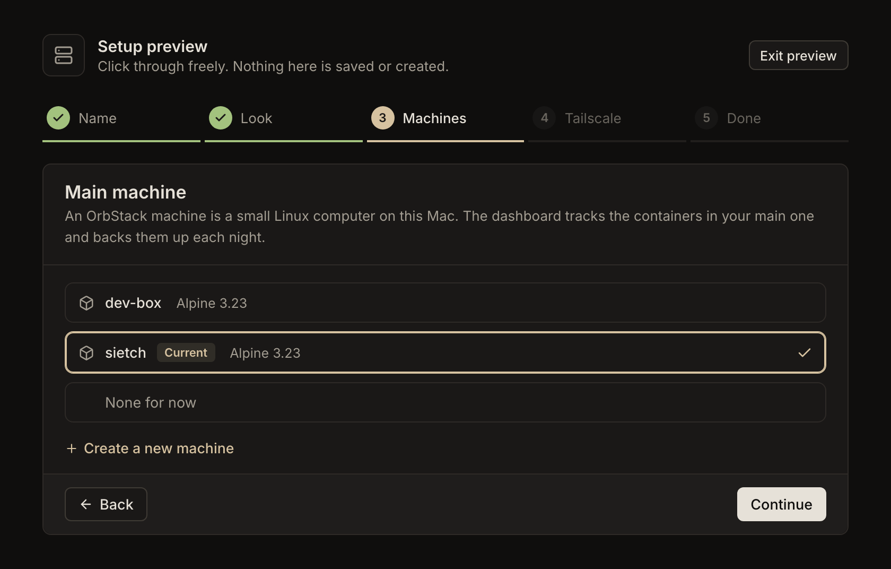
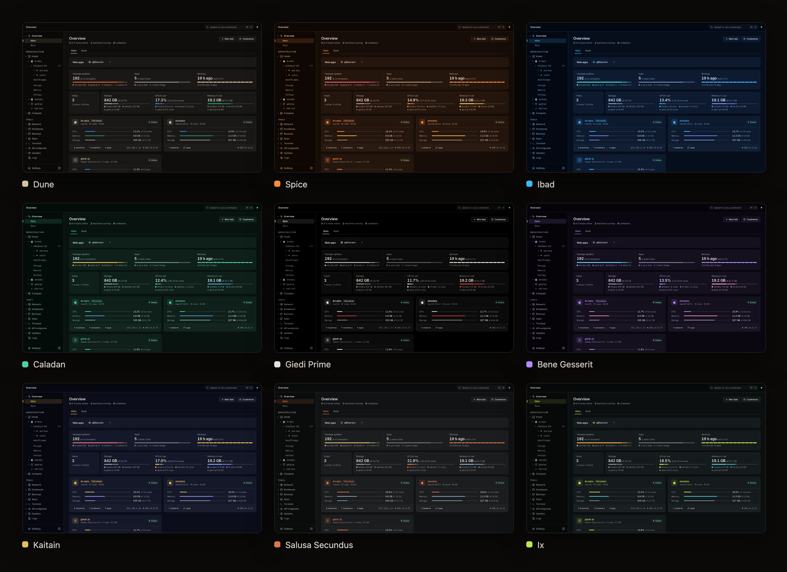
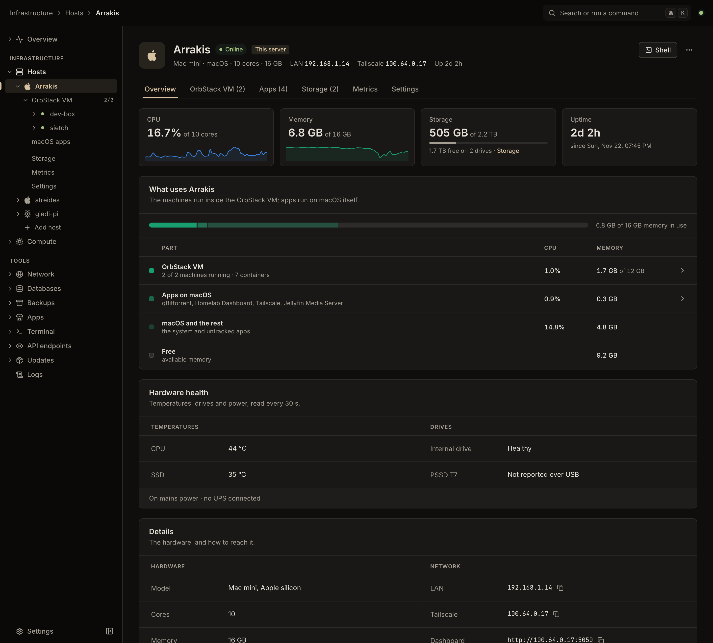
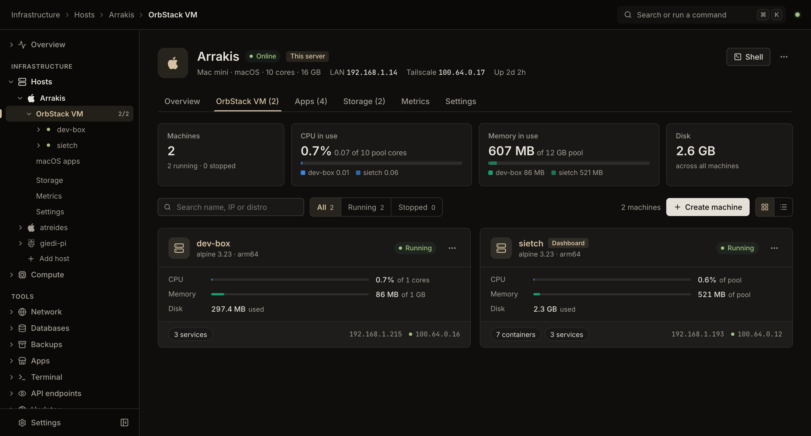
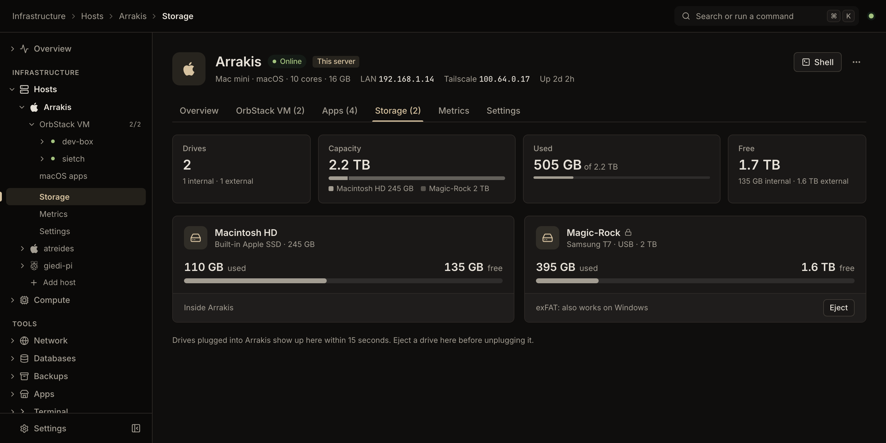
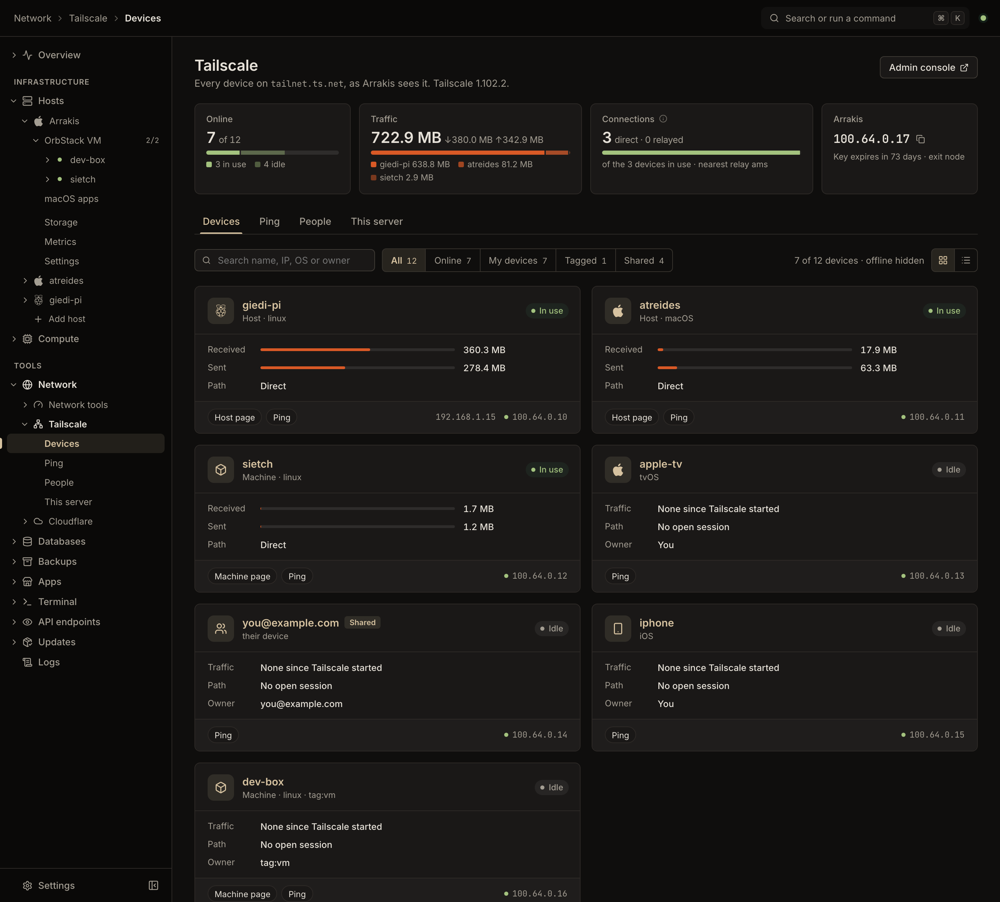
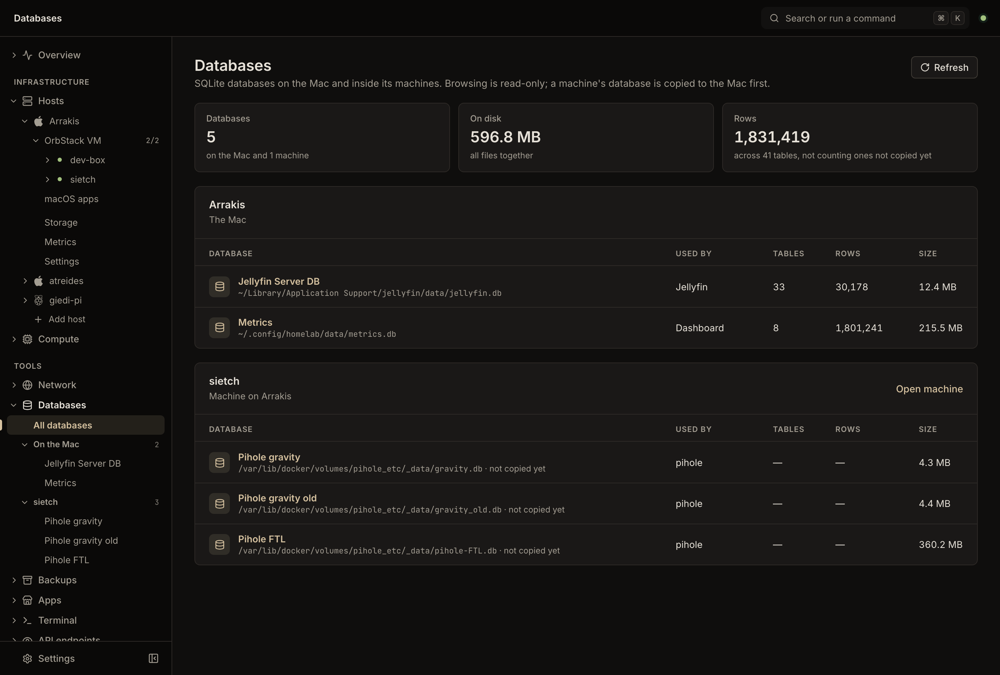

<div align="center">

# Homelab dashboard

**One page for a home server and everything around it.**

The Mac it runs on, the OrbStack machines and containers inside it, the other computers on
your tailnet, Tailscale and Cloudflare, backups, databases, and a terminal that keeps
running when you close the tab.

<p>
  
  
  
  
  
</p>

<a href="#install">Install</a> ·
<a href="#a-tour">Tour</a> ·
<a href="#other-computers">Other computers</a> ·
<a href="#security">Security</a> ·
<a href="#development">Development</a>

<br><br>



</div>

<br>

<table>
<tr>
<td width="33%" valign="top">

### 🖥️ One view of everything
Each host's CPU, memory and storage, with their history, on one page.

</td>
<td width="33%" valign="top">

### 📦 OrbStack machines
Create, limit, start/stop and share them, and see what runs inside.

</td>
<td width="33%" valign="top">

### 🛰️ Other computers
A small agent reports from any Mac or Linux box on your tailnet.

</td>
</tr>
<tr>
<td valign="top">

### 🗄️ Nightly backups
Apps, containers and folders on any host go into one snapshot.

</td>
<td valign="top">

### 📱 Works where you are
Open it from your phone over Tailscale. <kbd>⌘</kbd> <kbd>K</kbd> finds any page or action.

</td>
<td valign="top">

### 🔒 Yours only
Answers this computer and your own Tailscale devices. Nothing is public unless you share it.

</td>
</tr>
</table>

> [!NOTE]
> Built for macOS first: the server's own stats, drives and app list come from macOS tools.
> The agent for other computers runs on macOS and Linux.

## Install

```sh
git clone https://github.com/aikoschurmann/homelab ~/homelab
cd ~/homelab && ./install.sh
```

`install.sh` creates a Python venv, builds the web app and installs a service: a launchd
agent on macOS, or a systemd user service on Linux. Then open **<http://localhost:5050>**.

| You need | |
|---|---|
| **Python 3.10+** | with `venv` (`python3-venv` on Debian/Ubuntu) |
| **Node 20+** | Debian 12's own Node is 18; get 20+ from NodeSource or nvm |
| **bash** | Alpine: `apk add bash` |
| *Optional* | OrbStack, Tailscale, cloudflared, Docker, tmux. Pages light up for the tools you have |

### First run

The first visit walks you through five short steps: name the server, pick a look, choose
(or create) the main OrbStack machine, connect Tailscale, done.

<table>
<tr>
<td width="50%"></td>
<td width="50%"></td>
</tr>
</table>

Everything there can be changed later under **Settings**. On a server that's already set up,
`/?setup` replays the flow as a preview that saves nothing.

### Nine looks

Pick one during setup or under **Settings → General**, then fine-tune the accent, text size,
corners and motion.



<details>
<summary>The look step in setup</summary>
<br>

</details>

## A tour

### Overview

Every host side by side with its CPU, memory and storage, pending updates, the last backup,
and who is using the tailnet right now.


### Hosts

The server's own page shows what uses it: the OrbStack VM, apps on macOS and the system,
plus temperatures and drive health. It also has tabs for its machines, apps, drives,
history and settings.



### Machines

OrbStack machines as cards or a table, each with live CPU and memory, its addresses, and
what runs inside. A machine's page shows its containers, services and open ports. It's also
where you set limits, open ports and share it through a Cloudflare Tunnel.

<table>
<tr>
<td width="50%"></td>
<td width="50%"></td>
</tr>
</table>

### Storage and Tailscale

Internal and external drives, with how full they are and an Eject button; a drive you plug
in shows up within 15 seconds. Every device on your tailnet, whether it's connected directly
or through a relay, its traffic with the server, and ping.

<table>
<tr>
<td width="50%"></td>
<td width="50%"></td>
</tr>
</table>

### Backups

A nightly snapshot of apps, container volumes and chosen folders, from this server, its
machines and other hosts. You pick how many to keep, and a second copy can go to an external
drive.


### Terminal, databases, API

| | |
|---|---|
| **Terminal** | tmux sessions on the Mac, any machine or another host, plus one-click saved commands |
| **Databases** | read-only browsing and SQL for SQLite files on the Mac and inside machines |
| **API endpoints** | every backend route with live response times and a "try it" button |

<table>
<tr>
<td width="50%"></td>
<td width="50%"></td>
</tr>
</table>

<details>
<summary>API endpoints</summary>
<br>

</details>

## Other computers

Under **Hosts → Add host** the dashboard gives you a one-line install command. Run it on the
other computer, which needs Tailscale and curl. A small shell agent then reports every 5
seconds over Tailscale; it runs under launchd on macOS, and systemd or cron on Linux. Its
stats, containers and backups then show up like the server's own.

## Everyday commands

| | |
|---|---|
| Update | `git pull && ./install.sh` |
| Restart | `launchctl kickstart -k gui/$(id -u)/com.homelab.dashboard` (macOS) · `systemctl --user restart homelab-dashboard` (Linux) |
| Run by hand | `./install.sh --no-service && ./run.sh` |
| Other port | `./install.sh --port 8080`, or Settings → This server |
| Logs | `~/.config/homelab/logs/dashboard.{out,err}` |
| Remove | `./uninstall.sh` keeps your settings; `--purge` deletes them |

## Where things live

Nothing the server writes goes into the checkout. It all lives in `$HOMELAB_HOME`
(default `~/.config/homelab`), so an install can be moved, backed up or wiped as a unit:

```
server.json        name, port, setup done
*.json             prefs, storage, backup config, terminal presets, shares
secrets/           Cloudflare token, Tailscale auth key, host tokens (0600, never sent to the browser)
data/metrics.db    history; other .db files here also show up on the Databases page
logs/              dashboard and backup logs
```

Older installs that kept `~/.homelab_*.json` and `~/.databases/metrics.db` are picked up on
first start. The files are copied, and the originals are left alone.

To run a second, separate instance (for testing, say):

```sh
HOMELAB_HOME=/tmp/homelab-test HOMELAB_PORT=5099 ./run.sh
```

## Security

> [!IMPORTANT]
> The dashboard only answers this computer and **your own** Tailscale devices. Requests from
> anywhere else, including OrbStack containers going through localhost, get a 403.

Other people on your tailnet (members, or people you shared a device with) can be let in
under **Settings → Access**, by their Tailscale login:

- **View** sees everything but changes nothing (no terminal, no backup downloads).
- **Full** can do everything except change access.

Nothing is reachable from the internet unless you share a machine through a Cloudflare
Tunnel yourself. Keys and tokens stay on the server and never reach the browser.

## Development

```
server/     Flask API, pollers and websockets  (app/api, app/core, app/services)
web/        Svelte 5 + ECharts; builds into server/static
scripts/    backup.sh, the job the Backups page schedules; screenshots/ for this README
docs/       screenshots for this README
```

```sh
./run.sh                                  # the server, in the foreground
cd web && npx vite build --watch          # rebuild the UI on save; reload the page
```

Shared UI building blocks live in `web/src/ui.css` and `web/src/components/ui/`.
New API routes go in `server/app/api/` and the catalog in `get_endpoints_config()` (`app/api/system.py`).

### Screenshots

Every image in this README comes from one script, run against a live dashboard:

```sh
cd scripts/screenshots
npm install && npx playwright install chromium   # once
npm run shoot                                    # everything, into docs/screenshots
npm run shoot -- --only overview,hero            # just some
npm run shoot -- --url http://other-host:5050    # another instance
```

It captures at 2× with motion off, sizes each shot to its page's content, and builds the
framed hero and the theme grid. Addresses, the tailnet name, emails, your user name and
your Cloudflare domain are swapped for placeholders before anything is captured. Other
names (devices, machines) go in `$HOMELAB_HOME/screenshots.json`, which stays on your
computer:

```json
{ "replace": { "my-laptop": "atreides" }, "machine": "sietch" }
```

Look over the images before committing them.

### Troubleshooting

<details>
<summary><b><code>pyexpat</code> / <code>XML_SetAllocTrackerActivationThreshold</code> errors on macOS</b></summary>
<br>
Homebrew's Python is built against a newer expat than macOS ships. <code>install.sh</code>
detects this and uses Homebrew's copy (<code>brew install expat</code>).
</details>

<details>
<summary><b>The dashboard doesn't come up</b></summary>
<br>
Check <code>~/.config/homelab/logs/dashboard.err</code>. Only one instance can hold the port,
and a second one exits.
</details>
