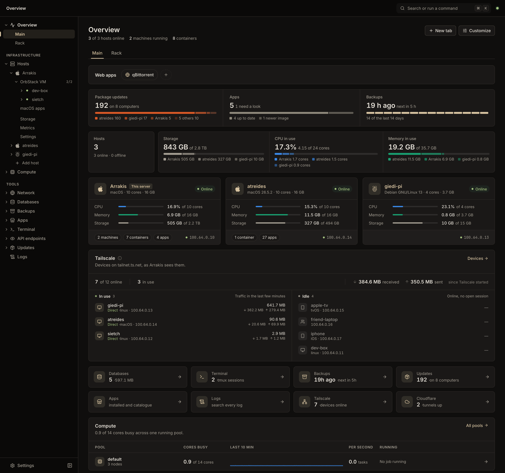
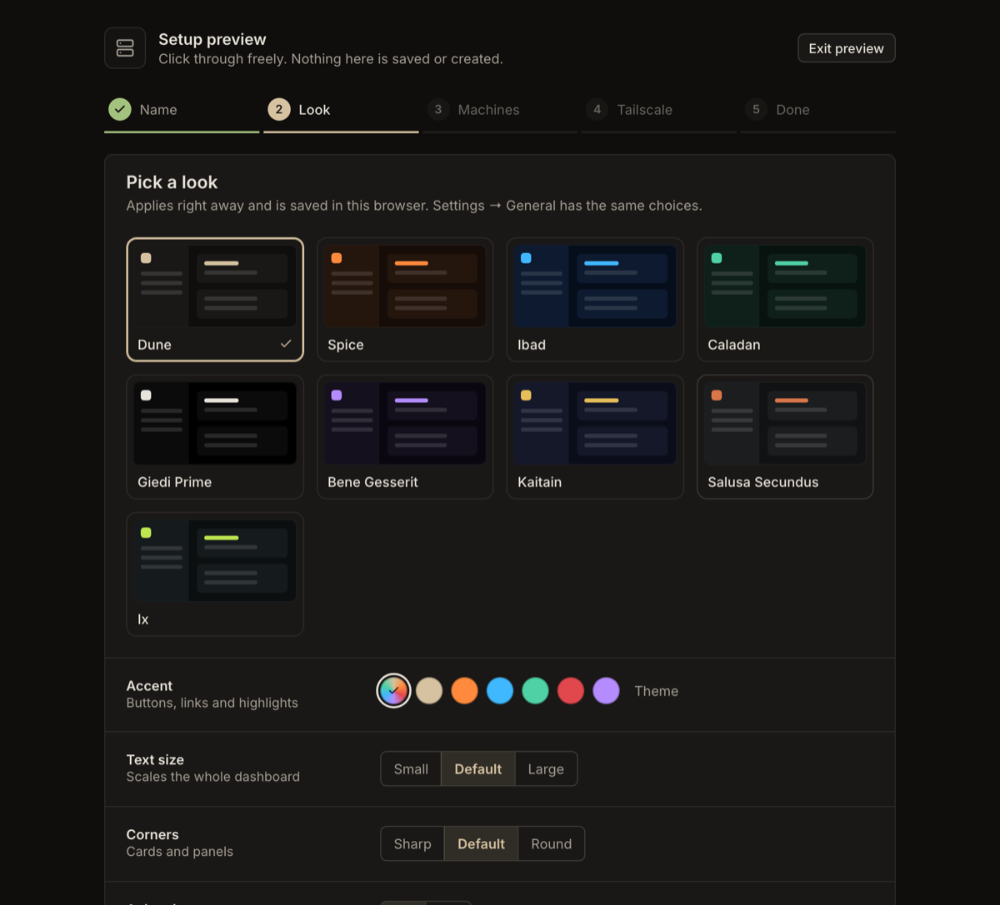
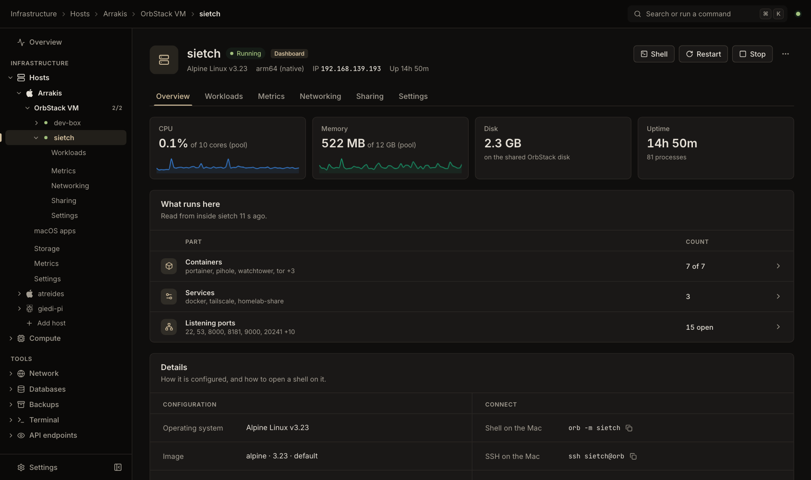
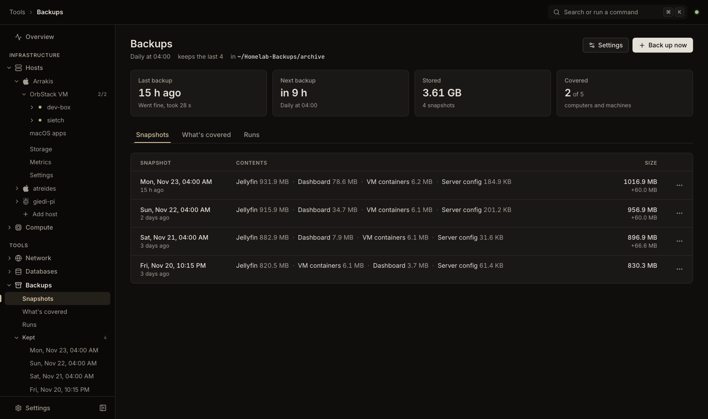
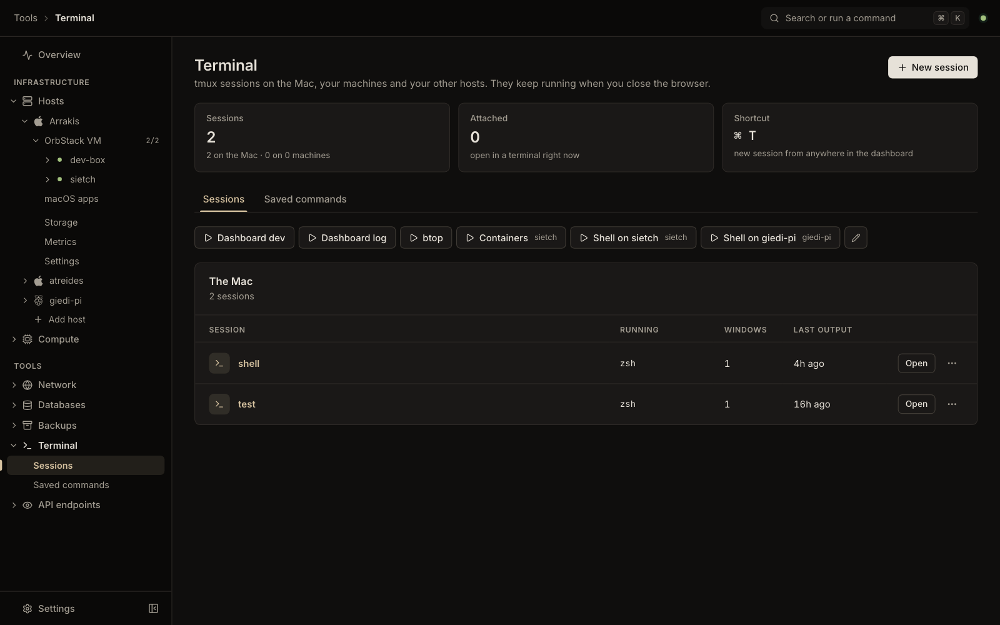
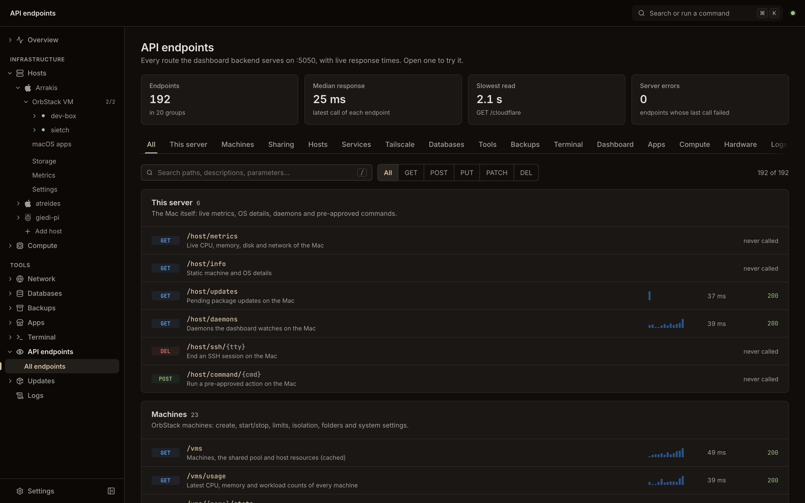

# Homelab dashboard

One page for a home server and everything around it: the Mac it runs on, the OrbStack
machines and containers inside it, the other computers on your tailnet, Tailscale and
Cloudflare, backups, databases and a terminal that keeps running when you close the tab.



- **One view of everything.** Each host's CPU, memory and storage, with their history.
- **OrbStack machines.** Create, limit, start/stop and share them, and see what runs inside.
- **Other computers.** A small agent reports from any Mac or Linux box on your tailnet.
- **Nightly backups.** Apps, containers and folders on any host go into one snapshot.
- **Works where you are.** Open it from your phone over Tailscale; ⌘K finds any page or action.

> Built for macOS first: the server's own stats, drives and app list come from macOS tools.
> The agent for other computers runs on macOS and Linux.

## Install

```sh
git clone https://github.com/aikoschurmann/homelab ~/homelab
cd ~/homelab && ./install.sh
```

`install.sh` creates a Python venv, builds the web app and installs a service: a launchd
agent on macOS, or a systemd user service on Linux. Then open <http://localhost:5050>.

You need **Python 3.10+** (with `venv`: `python3-venv` on Debian/Ubuntu), **Node 20+** and **bash**
(Alpine: `apk add bash`). Debian 12's own Node is 18; get 20+ from NodeSource or nvm. Pages light up for the tools you have installed:
OrbStack, Tailscale, cloudflared, Docker, tmux.

### First run

The first visit walks you through five short steps: name the server, pick a look, choose
(or create) the main OrbStack machine, connect Tailscale, done.


<details>
<summary>The look step</summary>
<br>

</details>

Everything there can be changed later under **Settings**. On a server that's already set up,
`/?setup` replays the flow as a preview that saves nothing.

## A tour

### Hosts

The server's own page shows what uses it: the OrbStack VM, apps on macOS and the system.
It also has tabs for its machines, apps, drives, history and settings.


### Machines

OrbStack machines as cards or a table, each with live CPU and memory, its addresses, and
what runs inside. A machine's page shows its containers, services and open ports. It's also
where you set limits, open ports and share it through a Cloudflare Tunnel.




### Storage

Internal and external drives, with how full they are and an Eject button. A drive you
plug in shows up within 15 seconds.


### Tailscale

Every device on your tailnet, whether it's connected directly or through a relay, its
traffic with the server, and ping.


### Backups

A nightly snapshot of apps, container volumes and chosen folders, from this server, its
machines and other hosts. You pick how many to keep, and a second copy can go to an external
drive.



### Terminal, databases, API

- **Terminal:** tmux sessions on the Mac, any machine or another host, plus one-click saved commands.
- **Databases:** read-only browsing and SQL for SQLite files on the Mac and inside machines.
- **API endpoints:** every backend route with live response times and a "try it" button.

<p>
  
  
</p>



## Other computers

Under **Hosts → Add host** the dashboard gives you a one-line install command. Run it on the
other computer, which needs Tailscale and curl. A small shell agent then reports every 5
seconds over Tailscale; it runs under launchd on macOS, and systemd or cron on Linux. Its
stats, containers and backups then show up like the server's own.

## Everyday commands

| | |
|---|---|
| Update | `git pull && ./install.sh` |
| Restart | `launchctl kickstart -k gui/$(id -u)/com.homelab.dashboard` (macOS) · `systemctl --user restart homelab-dashboard` (Linux) |
| Run by hand | `./install.sh --no-service && ./run.sh` |
| Other port | `./install.sh --port 8080`, or Settings → This server |
| Logs | `~/.config/homelab/logs/dashboard.{out,err}` |
| Remove | `./uninstall.sh` keeps your settings; `--purge` deletes them |

## Where things live

Nothing the server writes goes into the checkout. It all lives in `$HOMELAB_HOME`
(default `~/.config/homelab`), so an install can be moved, backed up or wiped as a unit:

```
server.json        name, port, setup done
*.json             prefs, storage, backup config, terminal presets, shares
secrets/           Cloudflare token, Tailscale auth key, host tokens (0600, never sent to the browser)
data/metrics.db    history; other .db files here also show up on the Databases page
logs/              dashboard and backup logs
```

Older installs that kept `~/.homelab_*.json` and `~/.databases/metrics.db` are picked up on
first start. The files are copied, and the originals are left alone.

To run a second, separate instance (for testing, say):

```sh
HOMELAB_HOME=/tmp/homelab-test HOMELAB_PORT=5099 ./run.sh
```

## Security

The dashboard only answers this computer and **your own** Tailscale devices. Requests from
anywhere else, including OrbStack containers going through localhost, get a 403.
Other people on your tailnet (members, or people you shared a device with) can be let in
under **Settings → Access**, by their Tailscale login: *View* sees everything but changes
nothing (no terminal, no backup downloads), *Full* can do everything except change access. Nothing is
reachable from the internet unless you share a machine through a Cloudflare Tunnel yourself.
Keys and tokens stay on the server and never reach the browser.

## Development

```
server/     Flask API, pollers and websockets  (app/api, app/core, app/services)
web/        Svelte 5 + ECharts; builds into server/static
scripts/    backup.sh, the job the Backups page schedules
docs/       screenshots for this README
```

```sh
./run.sh                                  # the server, in the foreground
cd web && npx vite build --watch          # rebuild the UI on save; reload the page
```

Shared UI building blocks live in `web/src/ui.css` and `web/src/components/ui/`.
New API routes go in `server/app/api/` and the catalog in `get_endpoints_config()` (`app/api/system.py`).

### Troubleshooting

- **`pyexpat` / `XML_SetAllocTrackerActivationThreshold` errors on macOS.** Homebrew's Python
  is built against a newer expat than macOS ships. `install.sh` detects this and uses Homebrew's copy (
  `brew install expat`).
- **The dashboard doesn't come up.** Check `~/.config/homelab/logs/dashboard.err`. Only one
  instance can hold the port, and a second one exits.
